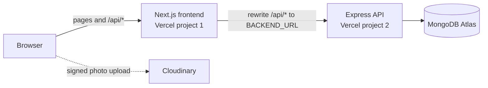

# Academy Desk

A web desk for sports academies. Coaches record attendance and matches, the app works out who is **Ready** for a trial, scouts see only the Ready players, and each player sees only their own record.

Built for Vibe Coding Challenge 2.0 by team **NRG**. The brief asked for a desk for one sports academy in Dumka; that academy ships as the seed data, and the app also lets other academies sign up, each one fully separate.

**Live app:** [vibe-coding-challenge-2-0-nrg.vercel.app](https://vibe-coding-challenge-2-0-nrg.vercel.app/) &nbsp;·&nbsp; **Try it:** on the sign-in page, use the one-click **Coach**, **Player** or **Scout** buttons.

---

## Contents

- [What it does](#what-it-does)
- [How the brief is met](#how-the-brief-is-met)
- [Run it locally](#run-it-locally)
- [Demo accounts](#demo-accounts)
- [Architecture](#architecture)
- [API](#api)
- [Security](#security)
- [Tests](#tests)
- [Project layout](#project-layout)
- [Limits and next steps](#limits-and-next-steps)

---

## What it does

**Coach**
- Adds players (name, age, sport) together with each player's login
- Runs practice sessions: **Open**, mark each player **Present** or **Absent**, then **Close**. A closed session is locked
- Records matches (date, sport, opponent) with each player's numbers for that sport, such as runs and wickets for cricket. Only players marked present that day can go on the sheet. A closed session has a button that opens the match form already set to that session's date and sport
- Sees the **Ready board**: attendance, matches played and Ready status for every player
- Manages players, scouts and other coaches in **Profiles**, and the academy's name, town and sports in **Academy settings**

**Scout**
- Asks an academy for access with an email address. A coach of that academy has to approve it first
- Sees only the academy's **Ready** players, with full profiles

**Player**
- Sees only their own profile: attendance over time, session history, matches and stats, and what is still missing to become Ready
- Can update their own photo, height, weight and nationality

**Ready** means at least **75% attendance** over closed sessions **and** at least **2 matches** played.

Every page works on phones, tablets and laptops (checked at 360, 390, 768, 1024 and 1440 px).

---

## How the brief is met

| Requirement from the brief | Where it is enforced | How to see it |
|---|---|---|
| Coach adds players (name, age, sport) | `POST /api/players`, coach only ([`backend/src/routes/players.js`](backend/src/routes/players.js)) | Coach → Profiles → Players → Add player |
| Sessions: Open → mark Present/Absent → Close, then locked | [`backend/src/routes/sessions.js`](backend/src/routes/sessions.js): marking or closing a closed session returns **409**; the write only matches `status: "open"`, so a close racing a mark cannot slip through | Coach → Sessions → open one, mark, close; the buttons disappear and the API refuses changes |
| Match: date, sport, opponent, per-player scores | [`backend/src/routes/matches.js`](backend/src/routes/matches.js), sport-specific stat fields in [`backend/src/constants.js`](backend/src/constants.js) | Coach → Matches → Record a match |
| Only players present that day can be on the sheet | [`backend/src/services/matchRules.js`](backend/src/services/matchRules.js): anyone absent or unmarked is refused with **422**, naming each refused player, and nothing is saved | Seed: a Football match on 2026-11-01 with Chandan is refused, he was absent |
| Ready = ≥ 75% attendance **and** ≥ 2 matches | `isReady` in [`backend/src/services/stats.js`](backend/src/services/stats.js), integer maths (`present × 4 ≥ held × 3`) so exactly 75% counts | Seed: Bina is at exactly 75% with 2 matches and is Ready; Chandan at 50% is not |
| Scout sees only Ready players | Filtered on the server in `GET /api/players` and `GET /api/players/:id` (a non-Ready player answers **404**) | Sign in as scout: 12 Ready players, no Chandan |
| Player sees only their own row | Same routes: a player's list holds only themselves; anyone else's profile answers **404** | Sign in as a player: only that player |
| Next.js + MongoDB + login with coach, player and scout roles | Next.js 16 frontend, Express + Mongoose backend, JWT in an httpOnly cookie, roles checked on every route | Sign-in page |
| Deployed live on Vercel | Two Vercel projects, `frontend/` (the public URL) and `backend/` | [vibe-coding-challenge-2-0-nrg.vercel.app](https://vibe-coding-challenge-2-0-nrg.vercel.app/) |
| Out of scope: payments, video, mobile app, chat, WhatsApp, maps | None of these are built | – |

All visibility rules live in the backend. The frontend hides things too, but calling the API directly gives the same filtered answers.

### Beyond the brief

- **Many academies.** Anyone can register an academy (name, town, the sports it runs, the first coach). Every player, session, match and account belongs to one academy, and every query is scoped to it. Another academy's records answer 404.
- **Seven sports with their own stats**: Football, Cricket, Badminton, Volleyball, Kabaddi, Hockey and Table Tennis.
- **Player profiles**: a performance radar against the academy's best, attendance over time, match-by-match charts and streaks, all computed from recorded data. Nothing is invented.
- **Scout access by request** with coach approval, and **several coaches** per academy.
- **Photos** uploaded straight from the browser to Cloudinary with a signed, single-purpose upload ticket.
- **Sport bar** above every list, remembered between pages.

---

## Run it locally

Needs **Node.js 20 or newer**. MongoDB is only needed for the full stack.

### Fastest: frontend only, with built-in demo data

```bash
cd frontend
npm install
cp .env.example .env.local        # NEXT_PUBLIC_USE_MOCKS=true
npm run dev                       # http://localhost:3000
```

With `NEXT_PUBLIC_USE_MOCKS=true` the frontend runs on an in-browser copy of the API with the same rules and the same seed data, so no backend or database is needed.

### Full stack

```bash
# 1. Backend
cd backend
npm install
cp .env.example .env              # set MONGODB_URI and JWT_SECRET (Cloudinary is optional)
npm run seed                      # wipes the database and loads the demo data
npm run dev                       # http://localhost:4000

# 2. Frontend, in a second terminal
cd frontend
npm install
cp .env.example .env.local        # then set NEXT_PUBLIC_USE_MOCKS=false
npm run dev                       # http://localhost:3000
```

`NEXT_PUBLIC_USE_MOCKS` is read at build time, so restart or rebuild the frontend after changing it.

### Environment variables

| File | Variable | What it is |
|---|---|---|
| `backend/.env` | `MONGODB_URI` | MongoDB connection string (Atlas or local) |
| | `JWT_SECRET` | Long random string used to sign the login cookie |
| | `PORT` | Defaults to 4000 |
| | `CLOUDINARY_CLOUD_NAME`, `CLOUDINARY_API_KEY`, `CLOUDINARY_API_SECRET` | Optional. Without them photo upload answers "not set up yet" and everything else works |
| `frontend/.env.local` | `BACKEND_URL` | Where `/api/*` is forwarded, e.g. `http://localhost:4000` |
| | `NEXT_PUBLIC_USE_MOCKS` | `true` for built-in demo data, `false` to use the backend |

No secrets are committed. Both folders have an `.env.example`.

### Useful backend scripts

| Command | What it does |
|---|---|
| `npm run seed` | Wipes the database and loads both demo academies |
| `npm run seed:empty` | Wipes it and loads only Dumka's coach and scout, to run the checks from scratch |
| `npm run seed:missing` | Wipes nothing: adds each demo academy only if it is not there yet. This is how the live database was filled, so it keeps anything created on the live site |
| `npm run migrate:academies` | For a database filled before academies existed: links everything to Dumka Sports Academy, deletes nothing |
| `npm test` | Unit tests |

---

## Demo accounts

All of them work on the [live app](https://vibe-coding-challenge-2-0-nrg.vercel.app/), whose database holds the same demo data as `npm run seed` and demo mode.

| Role | Username | Password | Notes |
|---|---|---|---|
| Coach | `coach` | `coach123` | Dumka Sports Academy, all 7 sports |
| Scout | `scout` | `scout123` | Sees Dumka's Ready players |
| Player | `dev` | `dev123` | Cricket, Ready |
| Player | `bina` | `bina123` | Football, exactly 75% attendance, Ready |
| Player | `chandan` | `chandan123` | Football, 50% attendance, not Ready |
| Pending scout | `new.scout@example.com` | `scout123` | Waits for a coach to approve |
| Other academy's coach | `ranchi` | `ranchi123` | Ranchi Hockey Academy (players `sahil`, `tanvi`): sees only its own 2 players, never Dumka's |

Every seeded player signs in with their lowercase first name and that name followed by `123`.

---

## Architecture



- **Two apps, one contract.** `frontend/` (Next.js 16, React 19, TypeScript, Tailwind 4) and `backend/` (Express 5, Mongoose, plain JavaScript) share only the JSON contract written down in [`AGENTS.md`](AGENTS.md) §4 and §5. The TypeScript types in [`frontend/src/types/index.ts`](frontend/src/types/index.ts) mirror it.
- **The browser only talks to the frontend.** Next.js forwards `/api/*` to the backend, so the login cookie stays first-party: no CORS, no third-party cookies.
- **Business rules live in one place**, the backend services: Ready in `services/stats.js`, match eligibility in `services/matchRules.js`, academy scoping in `middleware/auth.js` and `utils/academy.js`.
- **Dates are plain `YYYY-MM-DD` strings** throughout, so there are no time-zone shifts.
- **Demo mode.** [`frontend/src/mocks/server.ts`](frontend/src/mocks/server.ts) implements the same routes, rules and error shapes in the browser, so the frontend can be built and shown without a backend.

---

## API

All responses are JSON. Errors are always `{ "error": "message", "details"?: ... }`, never a stack trace. The full contract with every field is in [`AGENTS.md`](AGENTS.md) §4 and §5.

| Area | Endpoints |
|---|---|
| Auth | `POST /api/auth/login` · `POST /api/auth/logout` · `GET /api/auth/me` · `POST /api/auth/register-academy` · `POST /api/auth/register-scout` |
| Academy | `GET /api/academies` (public list) · `GET /api/academy` · `PATCH /api/academy` |
| Players | `GET /api/players` · `GET /api/players/:id` · `GET /api/players/:id/history` · `POST /api/players` · `PATCH /api/players/:id` · `POST /api/players/:id/photo-signature` |
| Sessions | `GET /api/sessions` · `POST /api/sessions` · `GET /api/sessions/:id` · `PATCH /api/sessions/:id/attendance` · `POST /api/sessions/:id/close` |
| Matches | `GET /api/matches` · `GET /api/matches/eligible` · `POST /api/matches` |
| Accounts | `GET/POST /api/users/scouts` · `PATCH /api/users/scouts/:id/approve` · `DELETE /api/users/scouts/:id` · `GET/POST /api/users/coaches` · `DELETE /api/users/coaches/:id` |

Status codes are used as meant: 400 bad input, 401 not signed in, 403 wrong role, 404 not found or not yours, 409 conflict (a locked session, a duplicate), 422 a match with players who were not present.

---

## Security

- Passwords hashed with **bcrypt**. A wrong username and a wrong password take the same time and give the same message.
- Login is a **JWT in an httpOnly, SameSite=Lax cookie**, `Secure` in production. JavaScript in the page cannot read it.
- **Every rule is checked on the server**: roles, the scout and player filters, academy scoping and session locks. The account and its academy are read again on every request, so a removed coach or scout loses access at once.
- A pending scout's account cannot sign in, and a wrong password never reveals whether an email is waiting for approval.
- **Input validation** on every route: bad dates, unknown sports, out-of-range numbers and stats a sport does not record are refused with a clear 400.
- **Photo uploads** are signed by the backend for one fixed path per player, and the backend only accepts a photo URL from that path.
- Secrets are in environment variables only; `.env` files are git-ignored.

---

## Tests

```bash
cd backend && npm test             # unit tests (node --test)
cd frontend && npm run typecheck   # TypeScript, no emit
```

The unit tests cover the Ready rule, including the exact-75% boundary and integer maths, the attendance percentages, the "academy best" figures behind the radar, and Cloudinary request signing, which is checked against Cloudinary's documented example.

The four checks from the brief can also be run by hand with the seed data, as listed in [`AGENTS.md`](AGENTS.md) §9.

---

## Project layout

```
backend/
  src/
    app.js              Express app, routes, central error handler
    middleware/auth.js  cookie → account → academy, role checks
    models/             Academy, User, Player, Session, Match
    routes/             auth, academies, players, sessions, matches, users
    services/           stats (Ready), matchRules, peers, cloudinary
    utils/              validation, academy helpers, JSON shapes
  scripts/              seed, migrate-academies
  test/                 unit tests
frontend/
  src/
    app/                pages: login, register-academy, register, coach/*, scout, me
    components/         AppShell, AuthTabs, PlayerProfile, PlayerTable, SportFilter, ...
    lib/                api client, formatting, sport stats, rating
    mocks/              in-browser API for demo mode
    types/              the shared contract in TypeScript
AGENTS.md               rules, contract, API, task list and seed data
```

---

## Limits and next steps

- **One-click demo sign-in.** The sign-in page signs anyone in as Dumka's coach, a player or the scout, which suits a judged demo. Remove `QUICK_ACCOUNTS` in [`frontend/src/components/AuthTabs.tsx`](frontend/src/components/AuthTabs.tsx) before real use.
- **No email verification or password reset.** A coach's approval is the gate for scouts.
- **No deleting players** yet, and a player's name, age and sport cannot be edited after creation.
- The public academy list shows names and towns only, so scouts can choose one.

[`AGENTS.md`](AGENTS.md).
